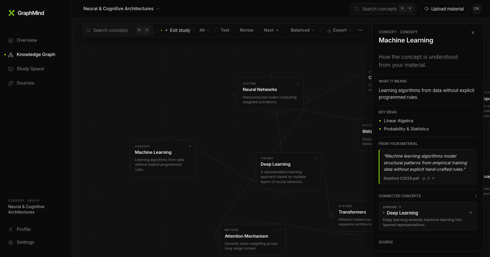
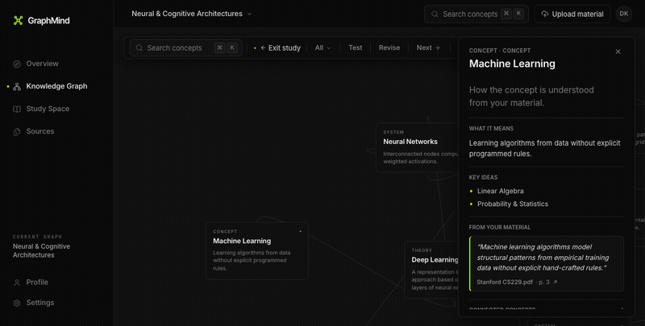
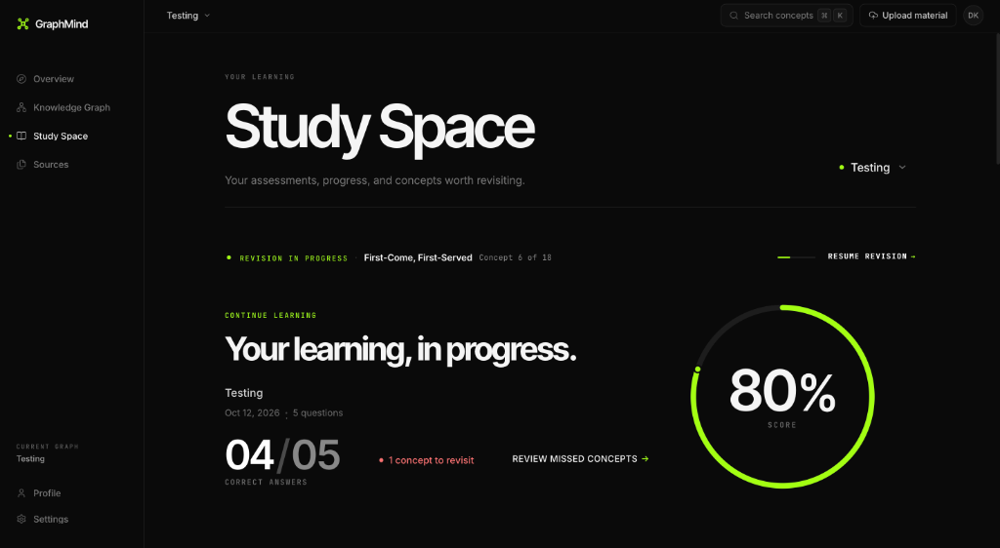
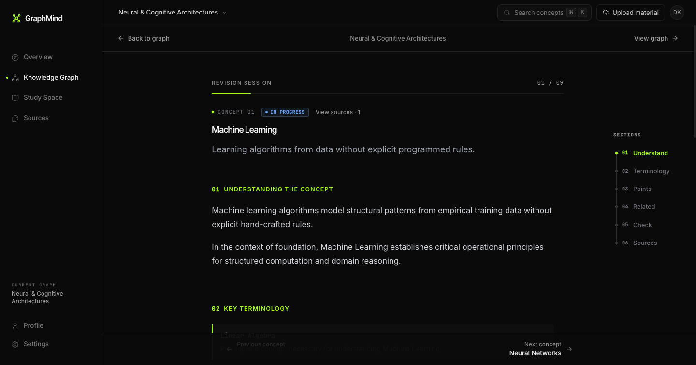
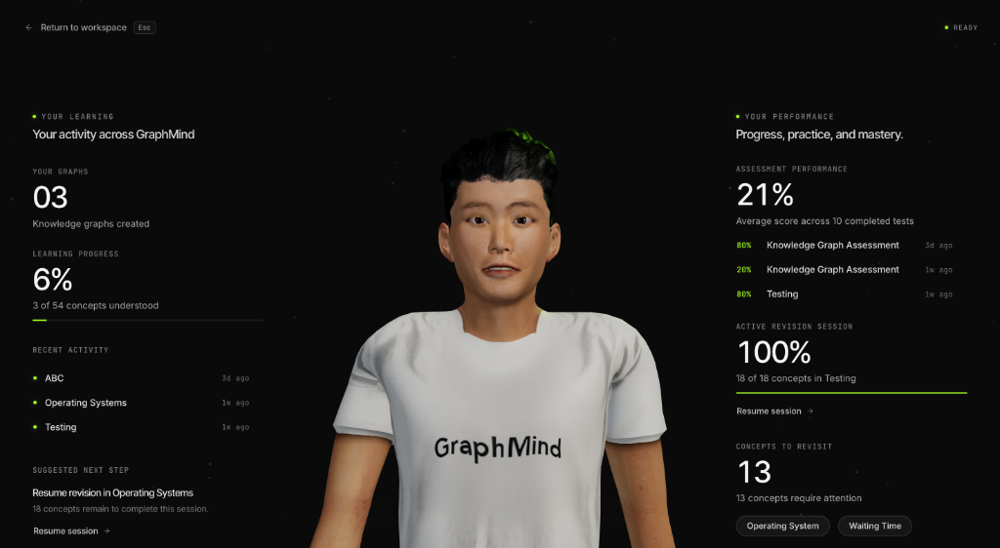
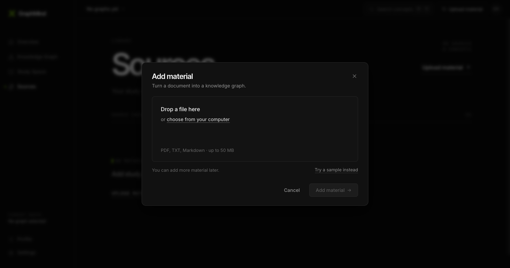
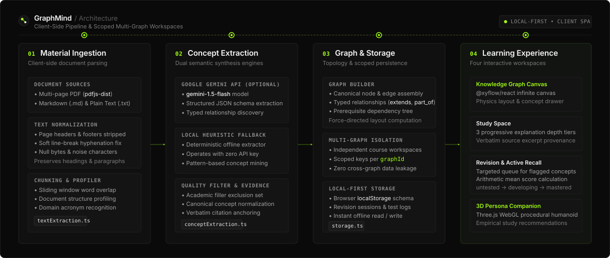

<div align="center">

# GraphMind

### Turn Your Notes Into Knowledge.

<p align="center">
  GraphMind transforms study materials—lecture slides, textbooks, and research papers—into interactive knowledge graphs, helping students explore relationships between concepts, assess their understanding, and focus their revision.
</p>

<p align="center">
  <em>Upload your material. Explore the ideas. Build lasting understanding.</em>
</p>

<p align="center">
  <a href="https://graph-mind-sandy.vercel.app/">
    
  </a>
  <a href="https://react.dev/">
    
  </a>
  <a href="https://www.typescriptlang.org/">
    
  </a>
  <a href="https://threejs.org/">
    
  </a>
  <a href="https://github.com/xyflow/xyflow">
    
  </a>
  <a href="LICENSE">
    
  </a>
</p>

<p align="center">
  <strong><a href="https://graph-mind-sandy.vercel.app/">🚀 Launch Live Application &rarr;</a></strong> &nbsp;&bull;&nbsp;
  <a href="#product-showcase">📸 Product Showcase</a> &nbsp;&bull;&nbsp;
  <a href="#features">✨ Core Features</a> &nbsp;&bull;&nbsp;
  <a href="#how-it-works">⚙️ How It Works</a> &nbsp;&bull;&nbsp;
  <a href="#architecture">🏛️ Architecture</a> &nbsp;&bull;&nbsp;
  <a href="#getting-started">⚡ Getting Started</a> &nbsp;&bull;&nbsp;
  <a href="#privacy--local-first-behavior">🔒 Privacy</a>
</p>

<br />

<a href="https://graph-mind-sandy.vercel.app/">
  
</a>

<p align="center">
  <sub><strong>Figure 1:</strong> The interactive Knowledge Graph canvas showing concept nodes, relationship physics, and the slide-over concept inspection drawer with verbatim source provenance.</sub>
</p>

</div>

---

<a id="overview"></a>
## 🌟 What GraphMind Does

Linear reading and traditional flashcards often fail when studying complex, multi-layered domains. Textbooks and lecture notes present information sequentially, but true comprehension requires understanding how foundational definitions, mechanisms, and advanced applications connect.

**GraphMind** converts unstructured study materials—such as multi-page PDFs, Markdown lecture notes, and technical articles—into a structured, navigable knowledge graph:

1. **Topological Learning**: Explore concepts visually on an infinite canvas with force-directed physics and explicitly labeled relationship edges.
2. **Verbatim Source Grounding**: Every concept is anchored to exact citations from your uploaded materials to prevent hallucinations and enable instant verification.
3. **Active Recall & Mastery**: Deterministically generated knowledge checks evaluate concept retention, tracking mastery state transitions (`untested` &rarr; `developing` &rarr; `mastered`).
4. **Adaptive Revision Queues**: Spaced review queues surface bottleneck concepts based on empirical assessment scores.
5. **3D AI Learning Companion**: A procedural WebGL humanoid companion provides contextual observations, natural speech synthesis, and evidence-based study recommendations.

---

<a id="product-showcase"></a>
## 📸 Product Showcase

Explore the actual GraphMind application interfaces across each learning phase:

<br />

### 1. Interactive Knowledge Graph Canvas *(Core Experience)*
> **The central visual workspace.** Concepts are rendered as interconnected nodes with force-directed physics, typed relationship edges, neighbor highlighting, and an inspection drawer that details definitions, key ideas, and verbatim citations.

<div align="center">
  
  <p align="center">
    <sub><strong>Knowledge Graph:</strong> Interactive exploration of neural and cognitive architectures with the concept detail drawer open on the right.</sub>
  </p>
</div>

<br />

### 2. Interactive Node Selection & Drawer Slide-In
> Selecting any concept node brings up detailed breakdowns—what it means, key prerequisite ideas, exact citations from your uploaded files, and connected downstream concepts.

<div align="center">
  
  <p align="center">
    <sub><strong>Live Canvas Interaction:</strong> Selecting a concept node immediately highlights connected paths and slides open the concept inspection drawer.</sub>
  </p>
</div>

<br />

### 3. Study Space & Concept Trajectories
> Track your learning progress, review past assessment performance, and follow structured concept trajectories moving progressively from intuitive analogies to formal mathematical definitions.

<div align="center">
  
  <p align="center">
    <sub><strong>Study Space:</strong> Progress tracking with radial score dials (80% score), active revision status, and concepts flagged for review.</sub>
  </p>
</div>

<br />

### 4. Adaptive Revision Workspace
> A focused revision rail organized into progressive stages: *Understand*, *Key Terminology*, *Key Points*, *Related Concepts*, *Check*, and *Source Provenance*.

<div align="center">
  
  <p align="center">
    <sub><strong>Revision Workspace:</strong> Step-by-step revision breakdown for individual concepts with progressive section rails and source citations.</sub>
  </p>
</div>

<br />

### 5. 3D AI Persona Learning Companion
> A full-screen 3D companion built in Three.js and WebGL. It reads your actual quiz attempts and revision progress to provide contextual observations, natural speech synthesis, and empirical next-step recommendations without gamified distractions.

<div align="center">
  
  <p align="center">
    <sub><strong>3D Persona Stage:</strong> Central humanoid stage flanked by the learning activity panel (left) and empirical performance breakdown (right).</sub>
  </p>
</div>

<br />

### 6. Document Ingestion & Material Upload
> Drop in multi-page PDFs, Markdown notes, or plain text files. The client-side pipeline extracts clean text, partitions overlapping chunks, and triggers semantic synthesis.

<div align="center">
  
  <p align="center">
    <sub><strong>Material Ingestion:</strong> Drag-and-drop document upload modal supporting PDF, TXT, and Markdown files up to 50 MB.</sub>
  </p>
</div>

---

<a id="features"></a>
## ✨ Core Features

GraphMind is organized around what students and researchers need to achieve genuine concept mastery:

### 🕸️ Learn Visually
* **Interactive Pan & Zoom Canvas**: Explore conceptual networks using `@xyflow/react` with smooth force-directed physics and multi-touch canvas controls.
* **Typed Semantic Relationships**: Edges explicitly describe conceptual relationships (e.g., `prerequisite_for`, `extends`, `part_of`, `used in`) rather than generic undirected lines.
* **Neighborhood Isolation & Highlighting**: Selecting any node automatically highlights immediate prerequisite paths and downstream dependencies.
* **High-Resolution Export**: Export crisp, publication-ready snapshots of your knowledge graph for study sheets or presentations.

### 📖 Understand Concepts
* **Progressive Conceptual Depth**: Review concepts across three distinct tiers of understanding: foundational intuition, formal definitions, and rigorous worked examples.
* **Direct Source Attribution**: Every extracted concept is linked to verbatim text excerpts from your uploaded files, ensuring zero hallucinations and immediate provenance verification.
* **Prerequisite Tree Demarcation**: Identifies foundational bottlenecks so you master core requirements before advancing to downstream topics.

### 🔄 Revise Effectively
* **Targeted Spaced Review Queues**: Automatically surfaces missed, flagged, or decay-prone concepts to ensure efficient, targeted revision sessions.
* **Spaced Repetition Rail**: Review cards summarize key mechanisms and prompt active recall before re-testing.
* **Session Persistence**: Revision progress is saved per graph, allowing you to resume exactly where you left off.

### 🎯 Test Understanding
* **Concept-Grounded Knowledge Checks**: Multiple-choice questions constructed directly from the concepts and relationships present in your graph.
* **Verbatim Question Explanations**: Review detailed feedback explaining why the correct answer is valid based directly on source excerpts.
* **Baseline Diagnostic Testing**: Quickly evaluate baseline understanding across an entire knowledge graph.

### 📊 Track Learning
* **Empirical Score Tracking**: Calculates real arithmetic mean scores and maintains a complete historical log of all assessment attempts per graph.
* **Mastery State Transitions**: Concepts advance through objective states (`untested` &rarr; `developing` &rarr; `mastered`) based on real quiz performance.
* **Zero Gamification**: Eliminates artificial streak counters and deceptive "fluency percentages" in favor of factual, empirical progress.

### 🤖 Meet Your Learning Companion
* **Procedural 3D WebGL Humanoid**: An interactive Three.js character featuring procedural breathing cycles, natural eye saccades, and head tracking.
* **Contextual Observation Engine**: Synthesizes actionable study advice derived from your lowest-scoring concepts and unfinished revision sessions.
* **Voice Synthesis & Onboarding**: Welcomes first-time visitors with guided onboarding and greets returning students with tailored study suggestions.

### 🗂️ Multi-Graph Workspace Isolation
* **Independent Subject Workspaces**: Create and maintain distinct graphs for different courses (e.g., *Operating Systems*, *Deep Learning*, *Distributed Systems*).
* **Strict Boundary Isolation**: Sources, concepts, relations, assessment attempts, and revision queues never leak across graph boundaries.
* **Instant Switching & Management**: Switch, rename, or delete graphs directly from the workspace header with instant localStorage updates.

---

<a id="how-it-works"></a>
## ⚙️ How It Works

GraphMind follows a deterministic, five-stage client-side pipeline:

```
[ Upload Material ] (PDF / Markdown / Plain Text)
       ↓
[ Client-Side Extraction ] (pdfjs-dist parses text & removes headers/footers)
       ↓
[ Semantic Synthesis ] (Google Gemini API or Built-in Local Heuristic Engine)
       ↓
[ Graph Construction ] (Resolves canonical concepts & typed relationships)
       ↓
[ Scoped Local Storage ] (Persisted in browser localStorage under unique graphId)
       ↓
[ Interactive Workspaces ] (Knowledge Graph • Study Space • Revision • 3D Persona)
```

1. **Ingest**: You upload study files via the dropzone. Text extraction runs entirely inside your browser using `pdfjs-dist`.
2. **Normalize**: The system removes running headers, footers, soft hyphenations, and noise filler words.
3. **Extract**: Concepts and relationships are extracted using either the Google Gemini API (`gemini-1.5-flash`) or the local heuristic engine when running offline.
4. **Construct**: GraphMind deduplicates candidates into canonical concepts, maps prerequisite relationships, and computes topological layouts.
5. **Persist & Study**: The graph is stored in your browser's `localStorage` and made available across the Knowledge Graph canvas, Study Space, Revision Workspace, and 3D Persona.

---

<a id="architecture"></a>
## 🏛️ Architecture

GraphMind runs entirely in the browser as a local-first single-page application. This guarantees immediate responsiveness, complete data privacy, and offline operation for core graph features.

<br />

<div align="center">
  
  <p align="center">
    <sub><strong>Figure 2:</strong> High-level system architecture showing the four core layers: Material Ingestion, Concept Extraction, Graph &amp; Storage, and Learning Workspaces.</sub>
  </p>
</div>

<br />

### Layer Breakdown & Responsibilities

| Layer | Module / Service | Key Responsibilities |
|---|---|---|
| **Layer 1: Material Ingestion** | `textExtraction.ts`, `sourceIngestion.ts` | Multi-page PDF parsing via `pdfjs-dist`, Markdown tag cleaning, text normalization, and sliding-window chunking. |
| **Layer 2: Concept Extraction** | `conceptExtraction.ts`, `relationshipExtraction.ts` | Dual-engine extraction: structured Gemini LLM extraction (`gemini-1.5-flash`) with automatic fallback to local heuristic pattern matchers. Strips academic filler and generic noise. |
| **Layer 3: Graph Construction & Storage** | `graphBuilder.ts`, `graphLayout.ts`, `storage.ts` | Canonical concept deduplication, typed relationship mapping, force-directed layout computation, and scoped multi-graph isolation in `localStorage`. |
| **Layer 4: Learning Workspaces** | `KnowledgeGraphWorkspace.tsx`, `StudySpaceView.tsx`, `RevisionWorkspace.tsx`, `PersonaExperience.tsx` | High-performance interactive UI layers: `@xyflow/react` infinite canvas, multi-level study explanations, active recall revision rails, and Three.js WebGL humanoid stage. |

---

<a id="tech-stack"></a>
## 🛠️ Technology Stack

GraphMind is engineered with a modern, high-performance client-side stack:

| Domain | Technology | Exact Version | Purpose & Implementation |
|---|---|---|---|
| **Core Framework** | [React](https://react.dev/) | `^19.2.8` | Component architecture, custom hooks, and concurrent UI rendering |
| **Language** | [TypeScript](https://www.typescriptlang.org/) | `~6.0.2` | Strict end-to-end type safety across graph models, pipeline stages, and storage schemas |
| **Build & Tooling** | [Vite](https://vitejs.dev/) | `^8.3.0` | Ultra-fast development server, HMR, and optimized production bundler |
| **Graph Visualization** | [@xyflow/react](https://github.com/xyflow/xyflow) | `^12.12.0` | Pan-and-zoom infinite canvas, custom node renderers, dynamic edge labeling, and export |
| **3D Graphics** | [Three.js](https://threejs.org/) | `^0.186.1` | WebGL scene graph, procedural humanoid geometry, custom shaders, and lighting |
| **Animation & Motion** | [Framer Motion](https://www.framer.com/motion/) | `^14.0.0` | Accessible page transitions, modal choreographies, and layout animations |
| **Document Processing** | [PDF.js](https://mozilla.github.io/pdf.js/) | `^6.4.299` | In-browser PDF parsing and text stream extraction via legacy worker |
| **AI Integration** | [Google Gemini API](https://ai.google.dev/) | `gemini-1.5-flash` | High-precision structured concept extraction, relationship tagging, and knowledge checks |
| **Iconography** | [Lucide React](https://lucide.dev/) | `^1.49.0` | Clean, semantic vector icon system for workspace navigation and actions |
| **Testing & Quality** | Node Native Test Runner | `tsx --test` | High-speed native TypeScript unit and integration testing suite |
| **Code Linting** | [Oxlint](https://oxc.rs/) | `^1.81.0` | High-performance Rust-based static code analyzer |
| **Deployment** | [Vercel](https://vercel.com/) | Continuous | Global edge distribution and automated continuous deployment pipeline |

---

<a id="getting-started"></a>
## 🚀 Getting Started

Follow these steps to run GraphMind locally on your development machine.

### Prerequisites

* **Node.js**: `v20.0.0` or higher
* **npm**: `v9.0.0` or higher
* **Modern Web Browser**: Chrome, Firefox, Safari, or Edge with WebGL enabled
* *(Optional)* **Google Gemini API Key**: [Get an API key from Google AI Studio](https://aistudio.google.com/) for cloud-assisted concept extraction. If omitted, GraphMind automatically runs with the built-in local heuristic engine.

### Installation

1. **Clone the repository:**
   ```bash
   git clone https://github.com/Deepanshu-2006/GraphMind.git
   cd GraphMind
   ```

2. **Install project dependencies:**
   ```bash
   npm install
   ```

3. **Configure Environment Variables:**
   Create a `.env` file in the root project directory:
   ```env
   VITE_GEMINI_API_KEY=your_gemini_api_key_here
   ```
   > **Note**: GraphMind functions fully without an API key using its deterministic local heuristic extractor. Adding an API key enables Gemini 1.5 Flash for enhanced semantic concept extraction and knowledge checks.

4. **Start the local development server:**
   ```bash
   npm run dev
   ```
   Open [http://localhost:5173](http://localhost:5173) in your browser to begin exploring.

---

<a id="testing"></a>
## 🧪 Testing & Code Quality

GraphMind maintains an extensive test suite verifying graph state integrity, multi-graph boundary isolation, storage migrations, and persona kinematics.

```bash
# Run the complete TypeScript unit and integration test suite
npm test

# Run the high-speed Oxlint code linter
npm run lint

# Validate TypeScript types and build the production bundle
npm run build

# Preview the local production build
npm run preview
```

---

<a id="privacy--local-first-behavior"></a>
## 🔒 Privacy & Local-First Behavior

GraphMind is engineered around a transparent, local-first data architecture:

* **Local-First Persistence**: All knowledge graphs, study notes, assessment scores, and revision sessions are stored directly in your browser's `localStorage`. No server-side database stores your personal study content.
* **Client-Side Document Parsing**: PDF, Markdown, and plain text parsing runs entirely on-device inside your browser using `pdfjs-dist`. Documents are never transmitted to any private backend servers.
* **External AI Processing**: When configured with a Google Gemini API key, extracted text excerpts and synthesis prompts are transmitted directly from your browser to Google's Generative Language API over HTTPS. When no key is set, extraction runs completely offline on your device.
* **Zero Telemetry**: GraphMind includes no analytics tracking scripts, behavioral telemetry, or third-party advertising cookies.

---

<a id="contributing"></a>
## 🤝 Contributing

Contributions to GraphMind are welcome! Whether you are fixing bugs, improving documentation, or adding new features:

1. **Fork the repository** on GitHub.
2. **Create a feature branch:**
   ```bash
   git checkout -b feature/your-feature-name
   ```
3. **Commit your changes:**
   ```bash
   git commit -m "feat: add your feature description"
   ```
4. **Run tests and linting:**
   ```bash
   npm test && npm run lint && npm run build
   ```
5. **Push to your branch:**
   ```bash
   git push origin feature/your-feature-name
   ```
6. **Open a Pull Request** with a detailed explanation of your changes.

---

<a id="license"></a>
## 📜 License

This project is licensed under the [MIT License](LICENSE) &mdash; feel free to use, modify, and distribute this codebase according to the license terms.

---

<a id="author"></a>
## 👨‍💻 Author & Links

Developed by **Deepanshu Khatri**.

* **Live Application**: [https://graph-mind-sandy.vercel.app/](https://graph-mind-sandy.vercel.app/)
* **GitHub Repository**: [https://github.com/Deepanshu-2006/GraphMind](https://github.com/Deepanshu-2006/GraphMind)
* **Author GitHub**: [@Deepanshu-2006](https://github.com/Deepanshu-2006)

<div align="center">
  <sub>Understand the Connections. Master the Concepts.</sub>
</div>
