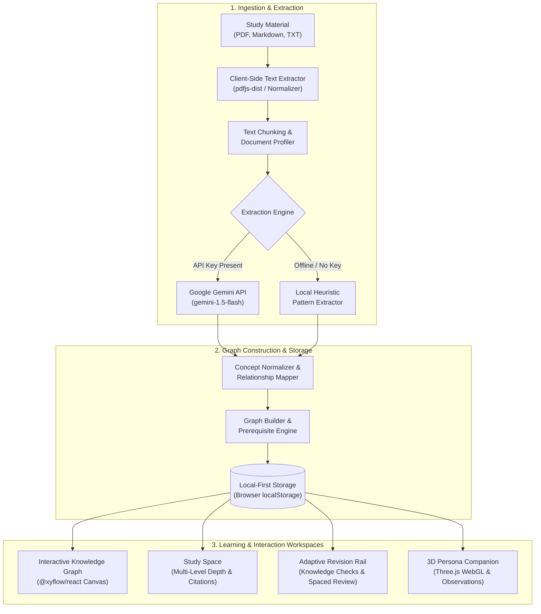

<div align="center">

# GraphMind

### Understand the Connections. Master the Concepts.

<p align="center">
  GraphMind transforms study materials into interactive knowledge graphs, helping students explore relationships between concepts, assess their understanding, and focus their revision.
</p>

<p align="center">
  <em>Upload your material. Explore the ideas. Build lasting understanding.</em>
</p>

<p align="center">
  <a href="https://graph-mind-sandy.vercel.app/">
    
  </a>
  <a href="https://react.dev/">
    
  </a>
  <a href="https://www.typescriptlang.org/">
    
  </a>
  <a href="https://threejs.org/">
    
  </a>
  <a href="https://github.com/xyflow/xyflow">
    
  </a>
  <a href="LICENSE">
    
  </a>
</p>

<p align="center">
  <strong><a href="https://graph-mind-sandy.vercel.app/">🚀 Live Demo</a></strong> &nbsp;&bull;&nbsp;
  <a href="#getting-started">⚡ Getting Started</a> &nbsp;&bull;&nbsp;
  <a href="#features">✨ Features</a> &nbsp;&bull;&nbsp;
  <a href="#product-showcase">📸 Product Showcase</a> &nbsp;&bull;&nbsp;
  <a href="#architecture">🏛️ Architecture</a> &nbsp;&bull;&nbsp;
  <a href="#privacy--data-handling">🔒 Privacy</a>
</p>

<br />


</div>

---

<a id="overview"></a>
## 🌟 Overview

Linear reading and rote memorization often fail when dealing with complex, multi-layered topics. Textbooks present ideas sequentially, but real understanding requires seeing how principles, mechanisms, and dependencies interconnect.

**GraphMind** bridges this gap by converting unstructured study materials—such as lecture slides, research papers, and technical book chapters—into structured, navigable knowledge graphs. Rather than flipping through static notes, learners can visually trace prerequisite hierarchies, inspect source provenance, take concept-grounded knowledge checks, and follow adaptive revision queues that focus attention where it is needed most.

---

<a id="product-showcase"></a>
## 📸 Product Showcase

The core learning workflows of GraphMind are organized around four primary views:

<br />

### 1. Interactive Knowledge Graph Canvas *(Core Experience)*
> **The central visual workspace.** Concepts are mapped as interconnected nodes on an infinite canvas with force-directed physics, labeled relationship edges, bidirectional neighbor highlighting, concept search, and a slide-over inspection drawer for deep dives.

```
+---------------------------------------------------------------------------------------+
|  [ KNOWLEDGE GRAPH CANVAS ]                                                           |
|                                                                                       |
|      (Concept: Backpropagation)                                                       |
|             |                                                                         |
|      [requires gradient] ---> (Concept: Gradient Descent) <--- [optimizes]            |
|                                         |                         |                   |
|                              (Concept: Loss Function)   (Concept: Learning Rate)      |
|                                                                                       |
|  * Node Inspection Drawer: Depth explanations (ELI5 -> Advanced) & source quotes      |
|  * Canvas Controls: Force-directed layout, depth filtering, high-res canvas export    |
+---------------------------------------------------------------------------------------+
```
*Tip: To view this live, load a benchmark graph or upload your study material in the [Interactive Workspace](https://graph-mind-sandy.vercel.app/).*

<br />

### 2. Study Space & Concept Trajectories
> Structured conceptual breakdowns moving progressively from intuitive analogies to formal definitions and worked examples. Every concept retains verbatim source provenance back to the exact passage in your uploaded document.

```
+---------------------------------------------------------------------------------------+
|  [ STUDY SPACE ]                                                                      |
|                                                                                       |
|  Concept Trajectory: Core Principles -> Mechanisms -> Advanced Applications           |
|                                                                                       |
|  [+] Progressive Depth:  Level 1 (Intuitive) | Level 2 (Formal) | Level 3 (Rigorous)  |
|  [+] Prerequisite Tree:  Bottleneck concept alerts before advancing                   |
|  [+] Verbatim Evidence:  Click-to-highlight source citations from uploaded PDFs       |
+---------------------------------------------------------------------------------------+
```

<br />

### 3. Material Ingestion & Extraction Pipeline
> Drag-and-drop document intake supporting multi-page PDFs, Markdown notes, and plain text. The client-side pipeline extracts clean text, partitions overlapping chunks, and extracts high-precision concepts and relationships using either Google Gemini or the built-in local heuristic engine.

```
+---------------------------------------------------------------------------------------+
|  [ MATERIAL INGESTION PIPELINE ]                                                      |
|                                                                                       |
|  Upload: Lecture_04_Optimization.pdf (32 pages)                                       |
|  Status: [Reading] -> [Analyzing] -> [Extracting Concepts] -> [Synthesizing Graph]    |
|  Result: 18 Canonical Concepts, 27 Semantic Relationships, 0 Data Leakage             |
+---------------------------------------------------------------------------------------+
```

<br />

### 4. 3D AI Persona Learning Companion
> A full-screen 3D companion rendered via Three.js and WebGL. It reads your real assessment history and revision queues to surface contextual observations, natural speech synthesis, and empirical next-step recommendations without distracting gamification.

```
+---------------------------------------------------------------------------------------+
|  [ 3D PERSONA STAGE ]                                                                 |
|                                                                                       |
|  WebGL Humanoid Canvas: Natural eye saccades, breathing cycles, procedural head yaw   |
|  Observation Engine:    Identifies lowest-scoring concepts from real quiz attempts    |
|  Actionable Next Step:  "Let's review Gradient Descent before testing backprop."      |
+---------------------------------------------------------------------------------------+
```

---

<a id="features"></a>
## ✨ Core Features

GraphMind is engineered around what students and researchers need to achieve mastery:

### 🕸️ Interactive Knowledge Graphs
* **Spatial Relationship Mapping**: Visualize conceptual networks using `@xyflow/react` on an infinite pan-and-zoom canvas.
* **Semantic Edge Labeling**: Relationships are explicitly typed (e.g., `prerequisite_for`, `part_of`, `contrasts_with`, `implements`) rather than generic undirected lines.
* **Neighborhood Isolation & Highlighting**: Selecting any node automatically highlights immediate prerequisite paths and connected downstream topics.
* **Canvas Export**: Export publication-ready, high-resolution snapshots of your knowledge graph for study sheets or presentations.

### 📖 Concept Exploration & Source Provenance
* **Multi-Tiered Depth**: Move seamlessly from foundational intuitions to rigorous mathematical descriptions and practical worked examples.
* **Direct Source Attribution**: Every extracted concept is linked to verbatim text excerpts from your uploaded materials, preventing hallucinations and allowing instant verification.
* **Prerequisite Identification**: Clearly demarcates foundational prerequisite concepts so learners do not jump ahead to advanced topics prematurely.

### 🎯 Assessments & Active Recall
* **Grounded Knowledge Checks**: Automatically generates multiple-choice questions grounded directly in the concepts and relationships present in your graph.
* **Empirical Score Tracking**: Calculates real arithmetic mean scores and maintains full attempt history per graph, avoiding arbitrary "fluency" gauges.
* **Mastery State Transitions**: Concepts objectively advance through state stages (`untested` &rarr; `developing` &rarr; `mastered`) based on real quiz performance.

### 🔄 Focused Spaced Revision
* **Targeted Revision Queue**: Automatically surfaces missed, flagged, or decay-prone concepts to ensure efficient, targeted review sessions.
* **Spaced Repetition Rail**: Review cards summarize key mechanisms and prompt active recall before re-testing.
* **Session Persistence**: Revision progress is saved per graph, allowing you to pick up exactly where you left off.

### 🤖 3D Learning Companion
* **Procedural WebGL Humanoid**: An interactive 3D character powered by Three.js featuring subtle procedural breathing cycles, natural eye saccades, and gaze tracking.
* **Contextual Observation Engine**: Synthesizes actionable observations derived from your actual assessment history and unfinished revision sessions.
* **Voice Synthesis & First/Returning Visit Flows**: Welcomes new learners through guided onboarding and greets returning students with targeted study recommendations.

### 📄 Document Ingestion & Processing
* **Client-Side Document Parsing**: High-fidelity PDF text extraction powered by `pdfjs-dist`, alongside Markdown and plain text file processors.
* **Text Normalization**: Strips running footers, page numbering artifacts, and soft hyphenations to preserve semantic integrity.
* **Dual Extraction Engines**: Seamlessly leverages the Google Gemini API (`gemini-1.5-flash`) for deep semantic extraction, with an automatic fallback to local heuristic pattern matchers when no API key is supplied.

### 🗂️ Multi-Graph Workspace Isolation
* **Complete Subject Separation**: Create and maintain distinct graphs for different courses or projects (e.g., *Operating Systems*, *Neurobiology*, *Compiler Design*).
* **Strict Boundary Isolation**: Sources, concepts, relations, quiz attempts, and revision queues never leak across graph boundaries.
* **Inline Graph Management**: Effortlessly switch, rename, or delete graphs directly from the workspace header.

---

<a id="tech-stack"></a>
## 🛠️ Technology Stack

GraphMind is built as a modern, high-performance client-side web application:

| Domain | Technology | Version | Purpose & Implementation |
|---|---|---|---|
| **Core Framework** | [React](https://react.dev/) | `^19.2.8` | Component architecture, custom hooks, and concurrent UI rendering |
| **Language** | [TypeScript](https://www.typescriptlang.org/) | `~6.0.2` | End-to-end type safety across graph models, pipelines, and state schemas |
| **Build & Tooling** | [Vite](https://vitejs.dev/) | `^8.3.0` | Next-generation frontend tooling and rapid HMR development server |
| **Graph Visualization** | [@xyflow/react](https://github.com/xyflow/xyflow) | `^12.12.0` | Infinite canvas, custom node renderers, dynamic edge labeling, and zoom/pan controls |
| **3D Graphics** | [Three.js](https://threejs.org/) | `^0.186.1` | WebGL scene graph, procedural humanoid geometry, custom shaders, and lighting |
| **Animation & Motion** | [Framer Motion](https://www.framer.com/motion/) | `^14.0.0` | Accessible page transitions, modal choreographies, and layout animations |
| **Document Processing** | [PDF.js](https://mozilla.github.io/pdf.js/) | `^6.4.299` | In-browser PDF parsing and text stream extraction via legacy worker |
| **AI Integration** | [Google Gemini API](https://ai.google.dev/) | `gemini-1.5-flash` | Structured concept extraction, relationship tagging, and knowledge checks |
| **Iconography** | [Lucide React](https://lucide.dev/) | `^1.49.0` | Crisp, semantic icon system for workspace navigation and actions |
| **Testing & Quality** | Node Native Test Runner | `tsx --test` | High-speed native TypeScript unit and integration testing suite |
| **Code Linting** | [Oxlint](https://oxc.rs/) | `^1.81.0` | High-performance Rust-based static code analyzer |
| **Deployment** | [Vercel](https://vercel.com/) | Continuous | Edge distribution and continuous deployment pipeline |

---

<a id="architecture"></a>
## 🏛️ Architecture

GraphMind runs entirely in the browser as a local-first single-page application. This guarantees immediate responsiveness, full privacy, and offline capability for core graph operations.

### Data & Execution Flow



### Layer Responsibilities

1. **Application & Workspace Shell (`App.tsx`, `AppShell`)**: Handles route state, modal overlays, graph switching, and unified navigation across views.
2. **Material Ingestion (`textExtraction.ts`, `sourceIngestion.ts`)**: Normalizes document formatting, resolves character encodings, strips running headers, and splits text into contextual chunks.
3. **Concept & Relationship Extraction (`conceptExtraction.ts`, `relationshipExtraction.ts`)**: Identifies core technical concepts, scores relevance against noise words, infers typed semantic relationships, and assigns confidence ratings.
4. **Graph State & Storage (`GraphContext.tsx`, `storage.ts`)**: Implements strict multi-graph isolation in `localStorage`. Graphs, practice states, assessment attempts, and revision queues are segregated under scoped storage keys.
5. **Interactive Visualization (`KnowledgeGraphWorkspace.tsx`)**: Bridges canonical graph models into `@xyflow/react` nodes and edges with force-directed positioning and node filtering.
6. **Learning & Assessment Engine (`knowledgeCheck.ts`, `conceptExplanation.ts`)**: Evaluates concept mastery levels and generates deterministic practice questions.
7. **Persona & Observation Engine (`PersonaExperience.tsx`, `personaObservations.ts`)**: Drives procedural 3D humanoid animation and translates real study data into contextual voice and text guidance.

---

<a id="getting-started"></a>
## 🚀 Getting Started

Follow these steps to run GraphMind locally on your workstation.

### Prerequisites

* **Node.js**: `v20.0.0` or higher
* **npm**: `v9.0.0` or higher
* **Modern Web Browser**: Chrome, Firefox, Safari, or Edge with WebGL enabled
* *(Optional)* **Google Gemini API Key**: [Get an API key from Google AI Studio](https://aistudio.google.com/) for cloud-powered concept extraction. If omitted, GraphMind automatically runs with the built-in local heuristic engine.

### Installation

1. **Clone the repository:**
   ```bash
   git clone https://github.com/Deepanshu-2006/GraphMind.git
   cd GraphMind
   ```

2. **Install project dependencies:**
   ```bash
   npm install
   ```

3. **Configure Environment Variables:**
   Create a `.env` file in the root project directory:
   ```env
   VITE_GEMINI_API_KEY=your_gemini_api_key_here
   ```
   > **Note**: GraphMind functions fully without an API key using its deterministic local heuristic extractor. Adding an API key enables Gemini 1.5 Flash for enhanced semantic extraction and question generation.

4. **Start the local development server:**
   ```bash
   npm run dev
   ```
   Open [http://localhost:5173](http://localhost:5173) in your browser to begin exploring.

---

<a id="testing"></a>
## 🧪 Testing & Code Quality

GraphMind maintains an extensive test suite verifying graph state integrity, multi-graph boundary isolation, storage migrations, and persona kinematics.

```bash
# Run the complete TypeScript unit and integration test suite
npm test

# Run the high-speed Oxlint code linter
npm run lint

# Validate TypeScript types and build the production bundle
npm run build

# Preview the local production build
npm run preview
```

---

<a id="privacy--data-handling"></a>
## 🔒 Privacy & Data Handling

GraphMind is designed around a transparent, local-first data model:

* **Local-First Persistence**: All knowledge graphs, generated questions, study notes, assessment scores, and revision sessions are stored directly in your browser's `localStorage`. No server-side database stores your personal study content.
* **Client-Side Document Parsing**: PDF, Markdown, and text parsing is executed entirely inside your browser using `pdfjs-dist`. Documents are not uploaded to any private backends.
* **External AI Processing**: When configured with a Google Gemini API key, extracted text chunks and synthesis prompts are transmitted directly from your browser to Google's Generative Language API over HTTPS. When no key is set, extraction runs completely offline on your device.
* **Zero Telemetry**: GraphMind includes no analytics tracking scripts, behavioral telemetry, or third-party advertising cookies.

---

<a id="license"></a>
## 📜 License

This project is licensed under the [MIT License](LICENSE) &mdash; feel free to use, modify, and distribute this codebase according to the license terms.

---

<a id="author"></a>
## 👨‍💻 Author & Links

Developed by **Deepanshu Khatri**.

* **Live Application**: [https://graph-mind-sandy.vercel.app/](https://graph-mind-sandy.vercel.app/)
* **GitHub Repository**: [https://github.com/Deepanshu-2006/GraphMind](https://github.com/Deepanshu-2006/GraphMind)
* **Author GitHub**: [@Deepanshu-2006](https://github.com/Deepanshu-2006)

<div align="center">
  <sub>Understand the Connections. Master the Concepts.</sub>
</div>
